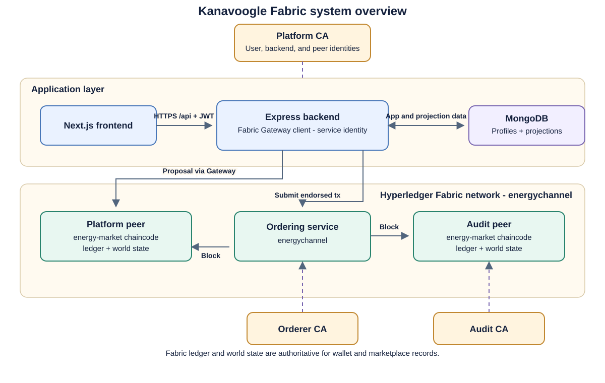
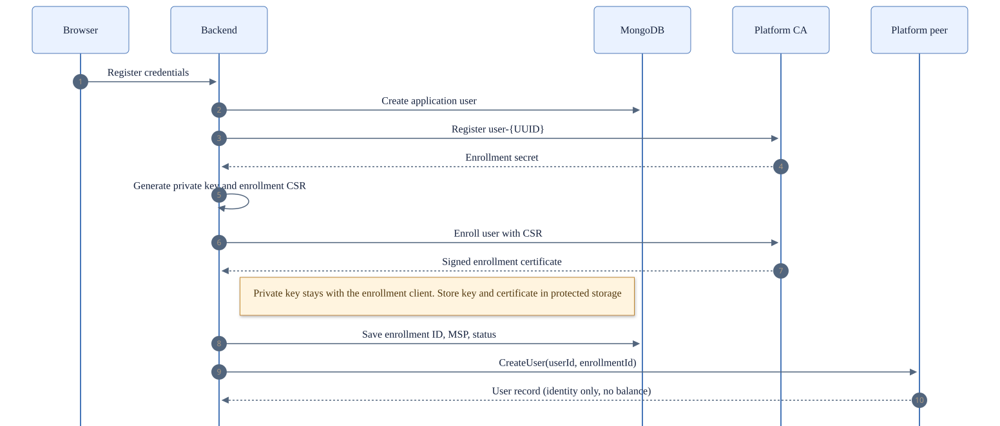
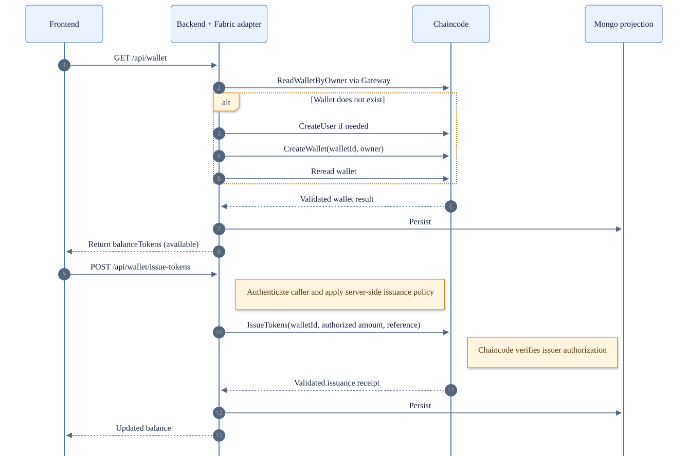
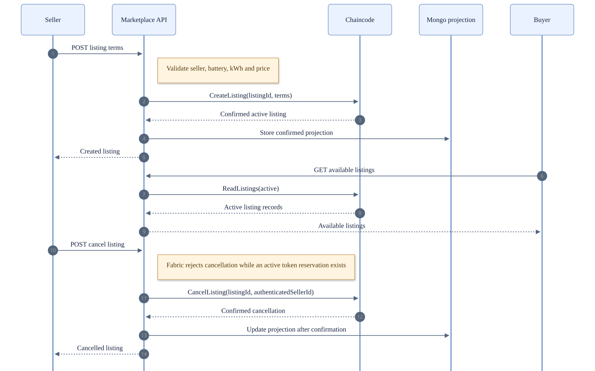
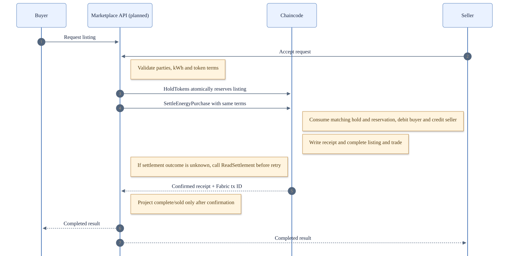

# Kanavoogle Fabric Handover

This guide explains how Hyperledger Fabric supports the Kanavoogle capstone. Use this guide to understand the network, certificate authorities, user identities, wallets, token issuance, energy listings, trade settlement, and deployment.

The repository source was reviewed on 12 October 2026. The chaincode package version is 0.5.0. The agreed target is a fresh channel and ledger at chaincode sequence 1. A read-only query on the VM on 12 October confirmed version 0.4.1 at sequence 3. The source changes the CreateUser signature and wallet ledger key and state formats. Do not deploy this fresh-start source over the existing VM ledger without an approved migration or reset plan.

## Architecture and current status

{ width=95% }

The frontend calls the Express API. The frontend does not connect to Fabric. The backend connects through Fabric Gateway and signs application transactions with the Platform backend service identity.

Fabric CA issues X.509 identities. Platform CA enrolls application users and the backend service. Chaincode runs on endorsing peers. The orderer orders endorsed transactions into blocks. Channel peers validate and commit blocks to their ledgers.

The energy-market contract source lives in this repository. Deployment packages and installs the source on Fabric peers. Peer nodes execute chaincode proposals. The orderer does not execute contract logic.

| Organization   | Role                                                                                    | Service                                     |
| -------------- | --------------------------------------------------------------------------------------- | ------------------------------------------- |
| OrdererOrgMSP  | Orders channel transactions.                                                            | orderer0.capstone.local                     |
| PlatformOrgMSP | Hosts the application peer, Platform CA, user identities, and backend service identity. | peer0.platform.capstone.local, CA port 7054 |
| AuditOrgMSP    | Hosts an independent peer and Audit CA.                                                 | peer0.audit.capstone.local, CA port 8054    |

Orderer CA listens on port 9054. The channel name is energychannel. Platform and Audit peers join the channel and hold a copy of the ledger. The deployment script collects lifecycle approval from both peer organizations. The transaction endorsement policy requires a Platform peer. The network has no private-data collection, so both channel organizations receive channel data.

MongoDB stores application profiles, battery records, operational listing fields, and projections. Fabric is the authority for wallet value, wallet history, listing terms and status, completed energy trades, and settlement receipts.

Current application integration:

- User registration provisions a Platform CA identity and submits CreateUser.
- Wallet reads, wallet history, and test token issuance use Fabric.
- Listing create, read, and cancel operations use Fabric.
- ReadWallets and ReadAllTransactions support backend projection rebuilds.
- The application does not yet call HoldTokens, SettleEnergyPurchase, or ReadSettlement.
- The application does not yet expose a Fabric-backed buyer request and seller acceptance flow.

## Certificate authorities and user identity

{ width=95% }

The application registration route is POST /api/auth/register. The backend creates the application account, then registers and enrolls a Platform CA identity. The enrollment ID follows this format:

    user-<application-user-UUID>

The application user record maps the user ID to the Fabric enrollment ID and MSP. The record also tracks the identity key, status, registration time, and last enrollment error. The backend stores signing material in its runtime identity directory. Keep private keys out of MongoDB, Git, and this guide.

After successful enrollment, the backend submits CreateUser. The Fabric user record stores the application user ID, enrollment ID, status, and timestamps. The record does not store balanceCents or token value.

POST /api/auth/login authenticates the application account. Login does not enroll a CA identity or submit a chaincode transaction.

DELETE /api/account deactivates the application account and attempts CA revocation. The route does not call DeactivateUser. CA revocation alone does not distribute a channel MSP certificate revocation list. The Fabric user record stays ACTIVE after application deactivation because the route skips DeactivateUser. Wallet methods do not enforce the Fabric user status. Production work must coordinate account deactivation, chaincode access, and peer certificate revocation.

The Gateway invokes Fabric with the separately enrolled backend-service identity. Its enrollment certificate must carry both attributes:

    energyMarket.backend=true
    energyMarket.issuer=true

Chaincode checks energyMarket.backend for backend operations. IssueTokens also requires energyMarket.issuer. The Platform CA registration script adds these attributes during initial service identity registration. Running the script again does not change an existing identity. Re-enroll the service identity and update the runtime certificate and key after an attribute change.

The backend maps the authenticated application user to the registered Fabric enrollment. The browser must not choose a wallet owner, buyer, seller, or balance. The backend must derive those values from the authenticated session and trusted application records.

Use a CA URL hostname listed in the CA TLS certificate's Subject Alternative Name. TLS verification fails when the URL hostname does not match a certificate name. Do not disable TLS verification to work around a name mismatch.

Useful network scripts, run from the Fabric repository root:

    bash network/scripts/bootstrapNetwork.sh
    bash network/scripts/registerUser-platform.sh <enrollment-id> <secret>
    bash network/scripts/revokeUser-platform.sh <enrollment-id> [reason]
    bash network/scripts/exportBackendEnv.sh

bootstrapNetwork.sh starts the Fabric services, creates the channel, and deploys chaincode for initial setup. The script does not reset an existing ledger. registerUser-platform.sh enrolls a Platform client identity. revokeUser-platform.sh revokes a CA identity. Peer rejection of an existing certificate also requires an MSP CRL update. exportBackendEnv.sh prints sensitive backend configuration, including encoded signing material. Protect its output.

## Wallets and test token issuance

{ width=95% }

Fabric stores one wallet per active application user. The backend derives the wallet ID as wallet-<application-user-ID>. Chaincode stores these fields:

- walletId
- ownerUserId
- ownerFabricEnrollmentId
- ownerMspId
- status, active or closed
- availableBalanceTokens
- heldBalanceTokens
- lastLedgerSequence
- lastFabricTransactionId
- createdAt and updatedAt

Available and held balances are whole-token integers. Total balance is derived from their sum. Chaincode has no balance setter. New wallets start active. The current contract has no operation to close a wallet.

The authenticated wallet endpoints are:

| Endpoint                                      | Behavior                                                                                                                |
| --------------------------------------------- | ----------------------------------------------------------------------------------------------------------------------- |
| GET /api/wallet                               | Reads or creates the caller's wallet through Fabric, then refreshes the MongoDB projection.                             |
| GET /api/wallet/history?pageSize=50&bookmark= | Returns immutable Fabric history in per-wallet sequence order. The bookmark is an opaque cursor.                        |
| POST /api/wallet/issue-tokens                 | Issues the backend-selected test amount. The request requires an Idempotency-Key header. Production disables the route. |

The issue-tokens endpoint is a test tool, not a purchase flow. The browser does not supply the amount or wallet ID. The backend derives the caller and wallet, then submits IssueTokens with a stable reference. Chaincode checks the issuer attribute. The backend disables the route when NODE_ENV=production. There is no public balance setter or currency conversion.

The development reference uses the application user ID and Idempotency-Key. A retry must reuse the same key and arguments. Chaincode returns the original issuance for a matching reference and rejects changed terms.

MongoDB stores this wallet projection:

    walletId, userId, status, balanceTokens, createdAt, updatedAt,
    lastFabricTransactionId, projectionUpdatedAt

balanceTokens means available, spendable tokens. The projection does not store heldBalanceTokens or totalBalanceTokens. Legacy balanceCents does not belong to wallet logic or token settlement.

Each value change appends a wallet ledger entry. Entry types are issue, hold, settlementDebit, and settlementCredit. Entries record the positive token amount, wallet IDs, marketplace transaction and listing IDs where relevant, reference, acting Fabric identity and role, Fabric transaction ID, timestamp, sequence, and resulting available and held balances.

Each wallet allocates a sequence number with the balance update and ledger entry. The composite key uses a 16-digit zero-padded sequence. ReadWalletHistory returns entries in ascending sequence order, including entries with equal timestamps. Rebuild wallet history by replaying entries in sequence order and checking the result against Fabric wallet state.

Wallet and listing keys:

    tokenWallet(walletId)
    tokenWalletByOwner(ownerUserId)
    tokenWalletLedger(walletId, zeroPaddedSequence)
    tokenWalletOperation(operation, sha256(reference))
    tokenWalletHold(holdId)
    tokenWalletSettlement(transactionId)
    energyListingReservation(listingId)
    energyListing(listingId)
    energyTransaction(transactionId)
    energyTransactionByUser(userId, transactionId)

Hold IDs use hold- followed by the SHA-256 digest of the marketplace transaction ID. Settlement IDs use settlement- followed by the same digest. Issue and hold operations use idempotency records.

## Energy listings

{ width=95% }

Energy quantities use kWh. Prices use whole tokens per kWh. Fabric does not store AUD values or currency conversions.

The application exposes these listing routes:

| Endpoint                                         | Access and behavior                                                                            |
| ------------------------------------------------ | ---------------------------------------------------------------------------------------------- |
| GET /api/marketplace/listings                    | Authenticated listing search with optional status filtering.                                   |
| GET /api/marketplace/listings/available          | Public read of available active listings.                                                      |
| GET /api/marketplace/listings/active             | Authenticated read of the caller's active listings.                                            |
| GET /api/marketplace/listings/mine               | Authenticated read of the caller's listings.                                                   |
| GET /api/marketplace/listings/:listingId         | Public read of one listing.                                                                    |
| GET /api/marketplace/listings/nearby             | Authenticated listing search with distance from the selected asset.                            |
| GET /api/marketplace/listings/:listingId/map     | Authenticated listing and application battery/location data.                                   |
| POST /api/marketplace/listings                   | Authenticated listing creation after seller, battery, permission, and available-energy checks. |
| POST /api/marketplace/listings/:listingId/cancel | Authenticated cancellation through Fabric.                                                     |

The backend adapter calls CreateListing, ReadListing, ReadListings, and CancelListing. Fabric stores listingId, seller userId, assetId, energyKWh, priceTokensPerKWh, status, timestamps, and the sale transaction ID when relevant. Listing status is active, cancelled, or sold. CreateListing does not move tokens.

MongoDB stores a rebuildable listing projection. The application also stores operational fields such as expiresAt, updatedAt, and pending submission state. The application labels a Fabric-cancelled listing expired when closedAt is at or after expiresAt. Expired is an application display value, not a Fabric status. Battery details and location remain application data.

ReadListings with status active omits a listing with an active token reservation. ReadListing by ID still returns the stored listing status, which stays active until settlement. A buyer must treat HoldTokens as the final availability check. CancelListing rejects a listing with an active reservation.

## Marketplace transaction and token settlement

{ width=95% }

Fabric supports token settlement. The application does not yet call the settlement transactions. MongoDB transaction records do not prove a Fabric token transfer.

The application request, seller acceptance, rejection, and cancellation states belong to the marketplace backend. The current backend does not expose a completed Fabric purchase flow or a Fabric BeginPurchaseHandshake operation.

The planned controlled-test flow is:

1. The buyer requests an active listing through the application.
2. The seller accepts the request.
3. The backend validates both users, wallets, listing ownership, kWh amount, token price, and total tokens.
4. The backend submits HoldTokens after seller acceptance. The call moves tokens from available to held and writes the hold, ledger entry, idempotency record, and listing reservation atomically.
5. The backend immediately submits SettleEnergyPurchase with the same transaction ID, listing ID, hold ID, wallets, and validated terms.
6. Fabric checks the listing, hold, reservation, wallets, energy, price, and total. Fabric consumes the hold, debits the buyer's held balance, credits the seller, appends both ledger entries, records the completed transaction and settlement receipt, and marks the listing sold in one transaction.
7. The application marks its trade completed and refreshes MongoDB projections only after confirmation from Fabric.

The contract checks totalTokens against the listing's kWh amount and whole-token price. The buyer cannot spend more than the available balance. The seller wallet must own the listing. Buyer and seller wallets and users must differ.

The reservation key is unique per listing. Competing HoldTokens transactions read and write the same key. Fabric MVCC validation allows only one competing hold to commit. The losing transaction does not commit wallet changes. The reservation does not add a public listing status. Settlement consumes the reservation.

HoldTokens and SettleEnergyPurchase are contract operations only. The backend does not call them yet. The contract has no ReleaseHold operation, no refund route, and no listing reassignment path after a confirmed hold. Do not create a hold before seller acceptance. Do not present a held purchase as cancellable. This is a controlled test flow, not a complete marketplace cancellation design.

For an unknown settlement result, call ReadSettlement with the same transactionId. If a receipt exists, use its Fabric transaction ID and result. If no receipt exists, retry only with the original transaction ID, hold ID, and identical terms. Do not create a new transaction or hold ID. A timeout does not prove failure. Never update MongoDB as completed before Fabric confirms settlement.

## Chaincode transaction catalog

Fabric Gateway passes transaction arguments as strings. Numeric strings still receive chaincode validation.

### User and wallet transactions

| Transaction          | Arguments in order                                                                                                             | Access and application status                                                             |
| -------------------- | ------------------------------------------------------------------------------------------------------------------------------ | ----------------------------------------------------------------------------------------- |
| CreateUser           | userId, fabricEnrollmentId                                                                                                     | Backend service. Called after successful CA enrollment.                                   |
| DeactivateUser       | userId                                                                                                                         | Backend service. Chaincode method exists. Account deactivation does not call this method. |
| CreateWallet         | walletId, ownerUserId, ownerFabricEnrollmentId, ownerMspId                                                                     | Backend service. Used by authenticated read-or-create wallet flow.                        |
| ReadWallet           | walletId                                                                                                                       | Reads one wallet summary.                                                                 |
| ReadWalletByOwner    | ownerUserId                                                                                                                    | Reads the wallet mapped to the application user.                                          |
| ReadWalletBalance    | walletId                                                                                                                       | Reads available, held, and derived total token amounts.                                   |
| ReadWalletHistory    | walletId, pageSize, bookmark                                                                                                   | Reads immutable ledger history in sequence order.                                         |
| ReadWallets          | pageSize, bookmark                                                                                                             | Backend-only wallet source for projection rebuilds.                                       |
| IssueTokens          | walletId, amountTokens, reference                                                                                              | Backend service plus issuer attribute. Used by test issuance route.                       |
| HoldTokens           | walletId, amountTokens, transactionId, listingId, idempotencyKey                                                               | Contract exists. Application integration pending.                                         |
| SettleEnergyPurchase | buyerWalletId, sellerWalletId, holdId, transactionId, listingId, energyAmountKWh, priceTokensPerKWh, totalTokens, buyerAssetId | Contract exists. Application integration pending.                                         |
| ReadSettlement       | transactionId                                                                                                                  | Reads a receipt before settlement retry. Application integration pending.                 |

### Listing and trade transactions

| Transaction               | Arguments in order                                       | Access and application status                                            |
| ------------------------- | -------------------------------------------------------- | ------------------------------------------------------------------------ |
| CreateListing             | listingId, userId, assetId, energyKWh, priceTokensPerKWh | Backend service. Used by listing creation.                               |
| ReadListing               | listingId                                                | Reads one listing. Used by listing reads.                                |
| ReadListings              | status                                                   | Reads active, cancelled, sold, or all listings. Used by listing reads.   |
| CancelListing             | listingId, userId                                        | Backend service. Used by listing cancellation.                           |
| GetListingHistory         | listingId                                                | Reads listing history. No backend adapter method exposes this read.      |
| ReadTransaction           | transactionId, requestingUserId                          | Reads a completed trade for the buyer or seller. Backend adapter exists. |
| ReadTransactionsForUser   | requestingUserId, pageSize, bookmark                     | Reads a user's completed trades. Backend adapter exists.                 |
| ReadAllTransactions       | pageSize, bookmark                                       | Backend-only completed-trade source for projection rebuilds.             |
| CompletePurchaseHandshake | transactionId, listingId, buyerId, buyerAssetId          | Rejected compatibility method. Do not use for settlement.                |

There is no ReleaseHold, CloseWallet, FreezeWallet, UnfreezeWallet, or BeginPurchaseHandshake transaction. Wallet status supports active and closed, but the contract has no operation to close a wallet. Newly created wallets are active.

## Data authority and projections

| Data                                                       | Authority                                                        |
| ---------------------------------------------------------- | ---------------------------------------------------------------- |
| Application login, profiles, battery records, and location | Application services and MongoDB.                                |
| User X.509 certificate and enrollment                      | Platform Fabric CA.                                              |
| Application user to Fabric enrollment mapping              | Application user record, checked by backend before Fabric calls. |
| Wallet balance and token history                           | Fabric wallet state and append-only ledger entries.              |
| Wallet display fields                                      | MongoDB projection. Rebuild from Fabric.                         |
| Listing terms and Fabric status                            | Fabric chaincode.                                                |
| Listing expiry, battery details, and location              | Application data.                                                |
| Completed trade and settlement receipt                     | Fabric. MongoDB stores a projection after confirmation.          |
| Private keys, CA admin secrets, and TLS material           | Protected runtime files and environment only.                    |

The wallet MongoDB projection stores walletId, userId, status, balanceTokens, createdAt, updatedAt, lastFabricTransactionId, and projectionUpdatedAt. balanceTokens means available tokens. Do not store heldBalanceTokens or totalBalanceTokens in this projection.

The completed transaction projection stores schemaVersion, transactionId, fabricTransactionId, listingId, sellerId, buyerId, assetId, buyerAssetId, energyKWh, priceTokensPerKWh, totalTokens, status, and completedAt. Its status is completed only. A MongoDB transaction record is not a settlement receipt.

ReadWallets and ReadAllTransactions provide paginated rebuild sources. They do not rebuild application profiles, CA credentials, battery records, listing data, or location. Fabric wallet history supports audit and balance reconstruction.

Run the projection rebuild command from the application repository root:

    npm run backend:db:rebuild:fabric-projections

The script reads all Fabric pages before writing. After successful reads and writes, the script removes stale rows only from wallet and completed-transaction projection collections. The rebuild leaves Fabric unchanged. Fabric pagination is a live view, not a snapshot. Pause issuance and settlement during a rebuild. Failed Fabric reads must not trigger stale-row pruning.

## Deployment and verification

GitHub stores source, scripts, templates, and documentation. The VM stores the running network, ledger, certificates, and runtime configuration. A Git pull does not deploy chaincode.

The agreed target uses a fresh channel and ledger with chaincode sequence 1. The source package version is 0.5.0. A read-only VM query on 12 October confirmed version 0.4.1 at sequence 3. Do not deploy the fresh-start contract to this ledger as an in-place upgrade. Do not reset or migrate the VM ledger without explicit approval.

For an approved source update, connect to the VM and inspect the committed definition:

    cd ~/code/T187_capstone-fabric
    git pull --ff-only origin main
    PATH="$HOME/hyperledger/fabric-samples/bin:$PATH" peer lifecycle chaincode querycommitted --channelID energychannel --name energy-market

Set FABRIC_CHAINCODE_VERSION and FABRIC_CHAINCODE_SEQUENCE in the VM's untracked .env for the target package and exact next sequence. Then run:

    bash network/scripts/deployChaincode.sh

The deployment script builds and packages chaincode, installs the package on Platform and Audit peers, collects both organization approvals, commits the definition, and checks the committed result. The transaction endorsement policy requires a Platform peer. The script exits when the requested sequence is not exactly one greater than the committed sequence. Fresh network setup uses sequence 1. A later approved upgrade uses the committed sequence plus one.

Use bootstrapNetwork.sh only for initial network setup. The script starts Fabric services, creates the channel, and deploys chaincode. The script does not reset an existing ledger. Inspect the live sequence before any deployment.

The application backend reads Fabric settings from protected runtime configuration. Relevant variable names include:

    FABRIC_PEER_ENDPOINT
    FABRIC_PEER_HOST_OVERRIDE
    FABRIC_MSP_ID
    FABRIC_CHANNEL
    FABRIC_CHAINCODE
    FABRIC_CLIENT_CERT_BASE64
    FABRIC_CLIENT_KEY_BASE64
    FABRIC_TLS_CA_CERT_BASE64
    FABRIC_CA_URL
    FABRIC_CA_NAME
    FABRIC_CA_ADMIN_ID
    FABRIC_CA_ADMIN_SECRET
    FABRIC_CA_AFFILIATION

Optional CA TLS root and identity-directory settings also apply. The frontend must never receive Fabric credentials. Keep real .env files and identity material out of Git. Confirm the CA URL hostname against the CA TLS certificate SAN.

Run chaincode tests from chaincode/energy-market:

    npm ci
    npm test

The test suite builds the TypeScript contract and checks wallet creation, issuer authorization, token validation, holds, listing reservations, settlement, idempotency, history, and projection reads.

## Remaining application work

1. Connect the marketplace backend to HoldTokens, SettleEnergyPurchase, and ReadSettlement.
2. Keep marketplace trades pending until Fabric confirms the settlement receipt.
3. Reconcile unknown submissions from Fabric before any retry or MongoDB update.
4. Add ReleaseHold or redesign the flow before supporting rejection, cancellation, refunds, or listing reassignment after a hold.
5. Coordinate application deactivation, DeactivateUser, and channel MSP CRL updates.
6. Define a supported wallet close operation before setting wallet status to closed.

See docs/wallet-integration.md, docs/transaction-integration.md, and chaincode/energy-market/README.md for transaction-level details.
